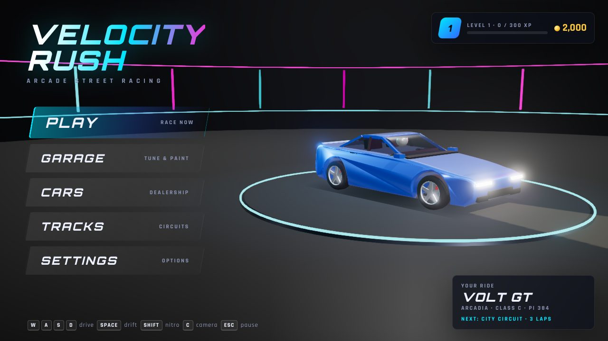
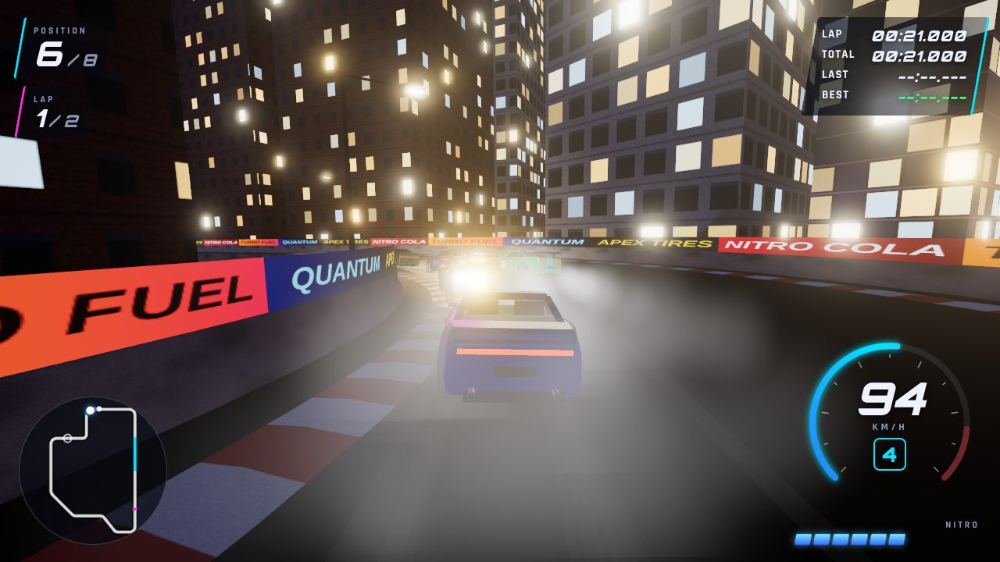
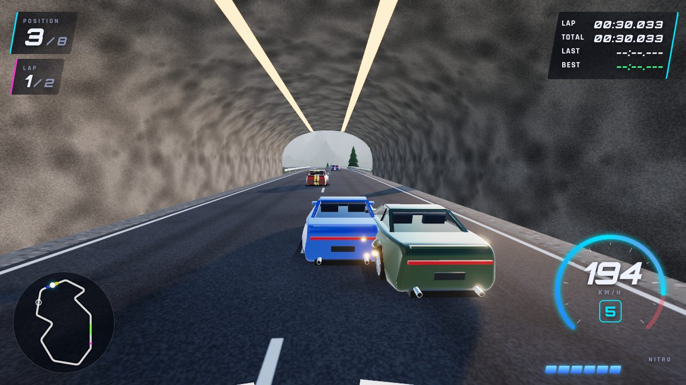
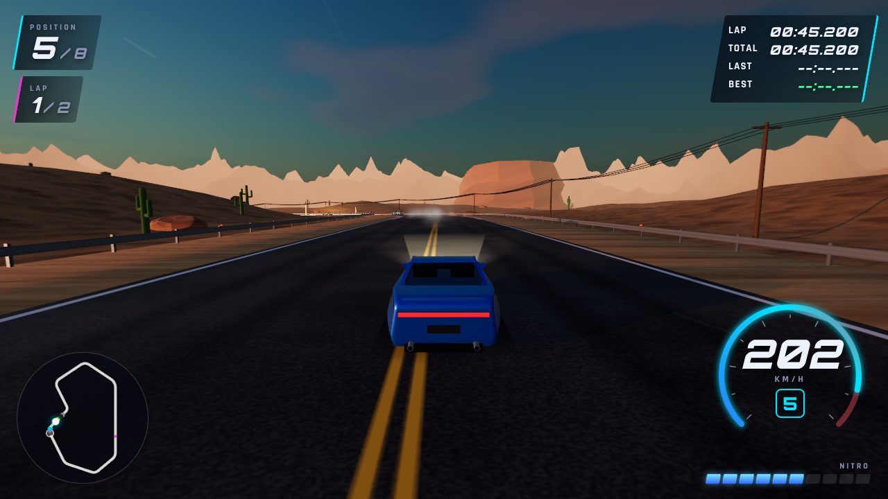
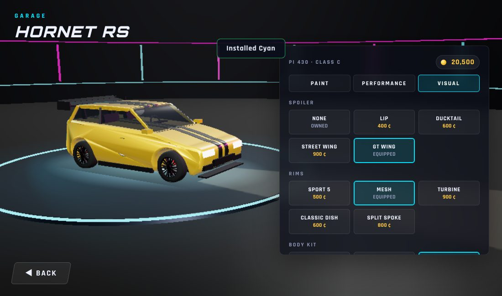
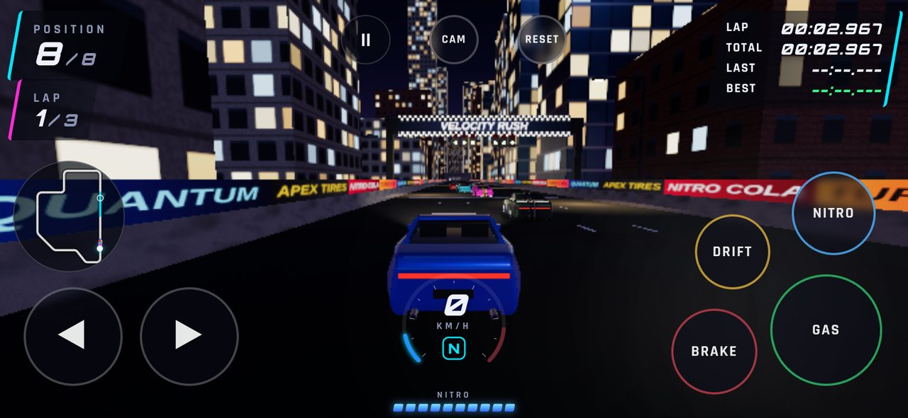

# Velocity Rush — 3D аркадная гонка в браузере

Полноценная браузерная 3D-гонка на **Three.js + TypeScript + WebGL**. Всё (машины, трассы, текстуры, звук и музыка) генерируется процедурно, поэтому ассеты не нужны: склонировал, установил зависимости и сразу играешь.



| City Circuit (ночь) | Mountain Track (тоннель) |
| --- | --- |
|  |  |
| **Desert Road (закат)** | **Гараж и тюнинг** |
|  |  |

## Быстрый старт

Нужен Node.js 18+.

```bash
cd racing-game
npm install
npm run dev          # http://localhost:5173 (откроется и в локальной сети)
```

Другие команды:

| Команда | Что делает |
| --- | --- |
| `npm run build` | проверка типов + сборка в `dist/` (можно выложить на любой статический хостинг) |
| `npm run preview` | локальный просмотр собранной версии |
| `npm run build:single` | сборка в **один файл** `dist-single/index.html`, его можно открыть двойным кликом без сервера |
| `npm run typecheck` | только проверка TypeScript |

## Управление

| Действие | Клавиатура | Геймпад | Телефон |
| --- | --- | --- | --- |
| Газ | `W` / `↑` | RT | кнопка GAS |
| Тормоз / задний ход | `S` / `↓` | LT | BRAKE |
| Руль | `A` `D` / `←` `→` | левый стик | кнопки ◀ ▶ или виртуальный руль |
| Ручник / дрифт | `Space` | B / X | DRIFT |
| Nitro | `Shift` | A | NITRO |
| Камера | `C` | Y | CAM |
| Сброс машины на трассу | `R` | Back | RESET |
| Пауза | `Esc` / `P` | Start | кнопка ❚❚ |

Клавиши можно переназначить: **Settings → Controls**. Тач-управление включается автоматически на сенсорных устройствах (или вручную в настройках), руль переключается между кнопками и «баранкой».



## Что есть в игре

**Геймплей.** Заезды на 1–5 кругов против 1–7 соперников (или тайм-триал), три уровня сложности, отсчёт 3-2-1-GO со стартовым светофором, контрольные точки со сплитами относительно лучшего круга, позиции в реальном времени, индикатор WRONG WAY, сброс машины (`R`) и автосброс AI, если он застрял. После финиша машина уходит на круг почёта под автопилотом, а камера облетает её. Затем экран **RACE FINISHED** с позицией, временем, лучшим кругом, наградами и таблицей результатов.

**Физика** (своя, аркадная, с фиксированным шагом 120 Гц): кривая разгона, максимальная скорость, торможение, сцепление, боковое скольжение, занос на ручнике с продолжением дрифта и контррулением, сопротивление воздуха и качению, масса и момент инерции в столкновениях, автоматическая КПП с потерей тяги на переключении, съезд на песок/гравий/бордюр, уклоны. Машина не переворачивается: крен и тангаж — визуальная подвеска на пружинах. Столкновения с отбойниками и машинами считаются импульсами в точке контакта: при ударах машину может развернуть, а у стен работает аркадное выравнивание, чтобы её не «прибивало».

**Nitro.** Резкое ускорение и рост максимальной скорости, синее пламя из выхлопа, частицы, отъезд камеры и рост FOV, тряска, радиальный motion blur, хроматическая аберрация и линии скорости, звук двигателя становится агрессивнее, отдельный звук выброса и рёв. Запас восстанавливается сам и быстрее в заносе.

**6 машин** с характеристиками Speed / Acceleration / Handling / Braking / Nitro / Drift, у каждой свой силуэт, фары, фонари, выхлоп и звук мотора (4, 6, 8, 10 и 12 цилиндров, турбо):
Volt GT · Hornet RS · Kitsune S · Phantom V8 · Kaiju X · Spectre LM.

**Гараж:** цвет кузова (палитра и любой цвет), покрытие (gloss / metallic / pearl / matte), цвет дисков, цвет ливреи, тонировка, номер. Апгрейды 6 характеристик по 5 уровней с реальным влиянием на физику. Визуальные детали: 5 спойлеров, 5 типов дисков, обвесы (Sport / Widebody), декали (полосы, ливрея с номером), неоновая подсветка днища.

**3 трассы**, у каждой свои стартовая линия, финиш, чекпоинты, отбойники и декорации:
1. **City Circuit** — ночной город: небоскрёбы со светящимися окнами, фонари с пятнами света на асфальте, рекламные щиты и баннеры на стенах, тоннель на главной прямой, силуэт мегаполиса, проблесковые огни на антеннах.
2. **Desert Road** — песчаные дюны, столовые горы (мезы), скалы, кактусы, линия электропередач, длинные прямые.
3. **Mountain Track** — серпантин со шпильками, перепад высот 50 м, обрывы к озеру, два тоннеля в скале, хвойный лес, заснеженные пики.

Время суток выбирается перед заездом: Auto / Morning / Day / Sunset / Night.

**AI-соперники** ездят по той же физике, что и игрок: следуют гоночной траектории (out-in-out), планируют торможение по кривизне впереди, обгоняют более медленных (но не ныряют во внутренний радиус посреди поворота), используют Nitro на прямых, иногда ошибаются (поздний тормоз, широкая траектория, сброс газа, виляние), сами выбираются из тупиков. Сложность меняет мастерство, апгрейды и «резинку».

**HUD:** позиция, круг, время круга / общее / последнее / лучшее, спидометр с тахометром и передачей, сегментная шкала Nitro, мини-карта с соперниками и следующим чекпоинтом, сообщения (чекпоинт, круг, дрифт, финиш).

**Камеры:** третье лицо (плавное следование, наклон в поворотах, рост FOV со скоростью, показ борта в дрифте), камера на капоте, вид из кокпита (приборная панель, руль крутится), кинематографичный облёт на старте и финише. Тряска при ударах, на бордюрах, на высокой скорости и с Nitro.

**Графика:** PBR-материалы (лак с clearcoat, перламутр через iridescence, хром, стекло), отражения окружения через PMREM, динамические тени от солнца/луны, которые следуют за игроком, процедурное небо с облаками или ночное небо со звёздами и луной, туман, bloom, GTAO-ambient occlusion (Ultra) плюс контактные тени под машинами, дым из-под шин, пыль, искры, следы шин, пламя Nitro, линии скорости, motion blur. Пресеты Low / Medium / High / Ultra: разрешение рендера, тени, постобработка, MSAA/FXAA, плотность декораций, количество частиц.

**Звук** (Web Audio, полностью синтезирован): двигатель по оборотам и нагрузке с турбо и blow-off, переключение передач, хлопки выхлопа, визг шин при заносе и торможении, удары и скрежет о стены, Nitro, ветер, вибрация бордюров, фон для каждой трассы (город, ветер пустыни, птицы в горах), процедурная synthwave-музыка для меню и гонки, звуки интерфейса. Настоящие файлы подключаются без изменения кода (см. ниже).

**Прогрессия:** монеты, XP и уровни. Награды за место, победу, рекорд круга, дрифт и чистую гонку. Машины покупаются и открываются по уровню, трассы открываются по уровню или за монеты, апгрейды и детали покупаются. Локальная таблица рекордов для каждой трассы. Всё сохраняется в `localStorage`.

**Настройки:** качество графики, motion blur, FPS-счётчик, полноэкранный режим, громкость (общая / звуки / музыка), чувствительность руля, переназначение клавиш, режим тач-управления, камера по умолчанию, тряска, FOV, единицы скорости, имя гонщика, сброс прогресса.

## Архитектура

```
src/
├── main.ts                 точка входа, проверка WebGL
├── game/                   ядро приложения
│   ├── Game.ts             главный цикл, переход меню ↔ гонка, награды
│   ├── RaceSession.ts      заезд: сцена, фиксированный шаг физики, круги/чекпоинты, позиции, финиш
│   ├── Showroom.ts         3D-фон меню с машиной на поворотном столе
│   ├── Input.ts            клавиатура + геймпад + тач → ControlState, переназначение клавиш
│   ├── Settings.ts         настройки (localStorage)
│   ├── SaveManager.ts      профиль игрока, конфигурация заезда (localStorage)
│   ├── Progression.ts      экономика: уровни, награды, покупки, разблокировки
│   └── Leaderboard.ts      интерфейс LeaderboardService + локальная реализация
├── car/
│   ├── CarCatalog.ts       данные машин (статы, кузов, мотор, цены)
│   ├── Upgrades.ts         апгрейды, визуальные детали, CarConfig
│   ├── CarModelFactory.ts  процедурная модель (кузов, стекло, свет, обвесы, салон)
│   ├── WheelFactory.ts     процедурные колёса и диски
│   ├── Gearbox.ts          автоматическая КПП, обороты
│   └── Car.ts              сущность машины + интерфейс ControlSource
├── physics/
│   ├── VehicleSpecs.ts     статы 1..10 → физические параметры
│   ├── VehiclePhysics.ts   аркадная динамика (сцепление, занос, nitro)
│   └── CollisionSystem.ts  машина↔отбойник, машина↔машина (импульсы)
├── tracks/
│   ├── TrackCatalog.ts     описание трасс (полигон со скруглениями, тоннели, обрывы)
│   ├── TrackPath.ts        построение центральной линии
│   ├── Track.ts            выборка трассы, быстрые запросы ближайшей точки, сетка старта
│   ├── TrackMeshBuilder.ts дорога, бордюры, отбойники, тоннели, старт/финиш, чекпоинты
│   ├── Terrain.ts          рельеф с переменным шагом сетки
│   ├── Atmosphere.ts       небо, свет, туман, отражения по времени суток
│   └── environments/       окружение: City / Desert / Mountain + общие помощники
├── ai/                     RacingLine (гоночная траектория) + AIDriver
├── camera/                 CameraController (chase / hood / cockpit / cinematic, тряска)
├── audio/                  AudioManager, EngineSound, MusicPlayer, Ambience, AudioAssets
├── effects/                PostFX (bloom, GTAO, speed blur), частицы, следы шин, линии скорости
├── ui/                     UIManager, HUD, мини-карта, тач-управление, экраны меню
└── utils/                  математика, шум, ГПСЧ, процедурные текстуры, форматирование
```

Основные решения:

* **Данные отдельно от кода.** Машины и трассы задаются данными в каталогах, всё остальное (физика, модель, звук, магазин, мини-карта) выводится из них.
* **`ControlSource`** — общий интерфейс для водителя. Игрок (`PlayerController`), AI (`AIDriver`) и автопилот реализуют один и тот же интерфейс и управляют машиной через одну и ту же физику.
* **Детерминированная физика** с фиксированным шагом 1/120 с и интерполяцией при рендере.
* **Производительность:** геометрия объединяется по материалам (≈17 draw calls на машину), декор рисуется через `InstancedMesh`, рельеф — с переменной сеткой (детально у трассы, грубо вдали), частицы — одним draw call на систему, тени следуют за игроком.

## Как расширять

* **Новая машина** — добавьте объект в `CAR_CATALOG` (`src/car/CarCatalog.ts`): статы, размеры кузова, профиль мотора, цена, уровень. Модель, физика, звук и магазин подхватятся сами.
* **Новая трасса** — добавьте запись в `TRACK_CATALOG` (`src/tracks/TrackCatalog.ts`): вершины полигона с радиусами скругления и высотами, ширину, тоннели (`{ edge, from, to }`), обрывы, время суток. Для новой темы окружения напишите `EnvironmentBuilder` и зарегистрируйте его в `src/tracks/environments/index.ts`.
* **Свои звуки и музыка** — положите файлы в `public/audio/` и пропишите пути в `src/audio/AudioAssets.ts` (например, `music_race: 'audio/race.mp3'`). Всё, что не нашлось, продолжит синтезироваться.
* **Новый режим** — `GameModeId` в `SaveManager.ts`, правила финиша в `RaceSession`, награды в `computeRewards` (`Progression.ts`). Тайм-триал можно взять за образец.
* **Онлайн-таблица лидеров** — реализуйте интерфейс `LeaderboardService` (`src/game/Leaderboard.ts`) поверх своего API и подставьте вместо `LocalLeaderboard` в `Game.ts`.
* **Мультиплеер** — у `ControlSource` уже предусмотрен вид `'remote'`. Сетевой контроллер принимает ввод/состояние удалённого игрока и пишет его в `car.controls`. Фиксированный шаг физики упрощает синхронизацию (lockstep или state-sync).
* **Тюнинг** — новые детали добавляются в списки `*_OPTIONS` в `Upgrades.ts` и отрисовываются в `CarModelFactory.ts`. Новые параметры физики добавляются в `computeVehicleSpecs`.
* **Погода и день/ночь** — вся атмосфера описана структурой `AtmosphereParams` (`src/tracks/Atmosphere.ts`): положение солнца, цвета, туман, экспозиция, bloom, облака, фонари и фары. Плавная смена дня и ночи сводится к интерполяции параметров во времени. Для дождя добавьте систему частиц и снижение сцепления через `SurfaceInfo.grip`.

## Производительность

Целевой показатель — 60 FPS на обычном современном компьютере на пресете **High** (по умолчанию на ПК). На телефонах по умолчанию включается **Low**. Если кадров мало, понизьте качество в **Settings → Graphics**: плотность декораций и разрешение теней применяются со следующего заезда, остальное — сразу. FPS-счётчик включается там же.

Технические заметки: Three.js r186 (WebGLRenderer + EffectComposer), без физического движка. Своя аркадная модель оказалась предсказуемее и дешевле, а машина гарантированно не переворачивается.
